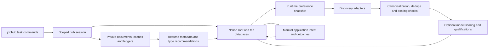

# Architecture

## Code map

- `cli.py`: parser and task routing; `commands/`: setup, task handlers, maintenance, and retained advanced operations.
- `workflow.py`: session, scoped discovery, preview stores, refresh dependencies, model reuse, run lock, health, dashboard, notifications.
- `storage.py` / `config.py`: independent paths, atomic private writes, OS secrets, TOML, and namespaced settings.
- `notion/hub.py`, `views.py`, `schema.py`, `validate.py`: ten-database template, root discovery, focused views, ownership and schema validation.
- `ingest/`, `ingest/direct_discovery.py`, `direct_adapter.py`: retained adapters, source planning, rate/health controls, public careers discovery.
- `pipeline/`: normalization, hashes, posting verification/date checks, scoring, persisted qualifications, answers, organizations, lifecycle reconciliation, outreach notifications, metrics.
- `library.py`: local content-addressed PDF catalog, staged facts, explicit approval, metadata sync, recommendation validation/cache.
- `transfer.py`: consistent local backups, validated restore, Notion snapshot, restartable one-way imports.
- `models/protocol.py`: small provider contract; LM Studio is the only implementation.
- `capture/`: optional authenticated server, explicit startup only.
- `scheduling.py`: opt-in launchd/systemd identities independent of other applications.

## Workflow dependencies

Preferences are loaded from Notion each refresh. Supported due sources ingest independently of model availability. Canonical resolution, fingerprints, and cached hashes avoid duplicate intake. Required posting verification runs before AI stages; each score queue also checks its own candidates. Unknown availability/date remains reviewable rather than invented or silently accepted. Invalid output leaves prior results intact and marks processing pending/failed. Human decisions are never model-generated application actions.

Lifecycle reconciliation is independent of AI success. Apply creates or reuses one Planned application, then links it to the opportunity; retry repairs an interrupted link without duplicating the row. Missing answers/resumes become Next Action advice. Outcome statuses are protected from routine rescoring.

Approved facts and answers provide evidence for qualification checks. Unapproved extracted PDF facts stay local. Resume recommendation prompts and validators accept only title, rationale, document ID, and job IDs; they have no writing/generation path. Existing manual resume selections remain intact.

## Repeated work and isolation

A session reuses its Notion client, browser runtime where passed through, and model/router. Existing description/score hashes, cache tables, retry ledgers, and recommendation-input hashes are retained. Library sync patches changed properties only. Sources respect due times and record health failures separately from empty results. A file lock prevents same-computer overlap between refresh, capture, and CLI writes.

Preview copies SQLite stores consistently into a temporary directory and blocks remote mutation at the Notion client. The notifier runs dry; user documents and persistent cache bytes remain unchanged. Inspection uses the same guard. Backups use an explicitly read-only remote client while allowing the requested local archive write.

The two projects share no runtime configuration, credentials, documents, Git history, notification ledger, capture/OAuth ports, or schedule labels. No installation or migration logic reaches into an older project.

## Validation boundaries and optimization opportunities

Synthetic fixtures cover template payloads, ownership, interrupted application linking, unknown/failed verification, invalid model output, optional embeddings, source errors, preview, credential-store failure, imports, backups, and locks. Live API rendering/access and real scheduler delivery require the disposable-workspace checklist.

Remaining useful optimization: unify the remaining advanced stage client wrappers with the shared runner; target-specific aggregate-source health instead of adapter-level health when a board adapter processes several employers; a smaller language-detection download if equivalent accuracy can be retained; and mutation diffs for all repeated Notion writes. These are medium priority and should follow live acceptance, not blanket dependency upgrades. Notion has no client uniqueness constraint; multi-computer writers require a coordination design beyond the local lock.
